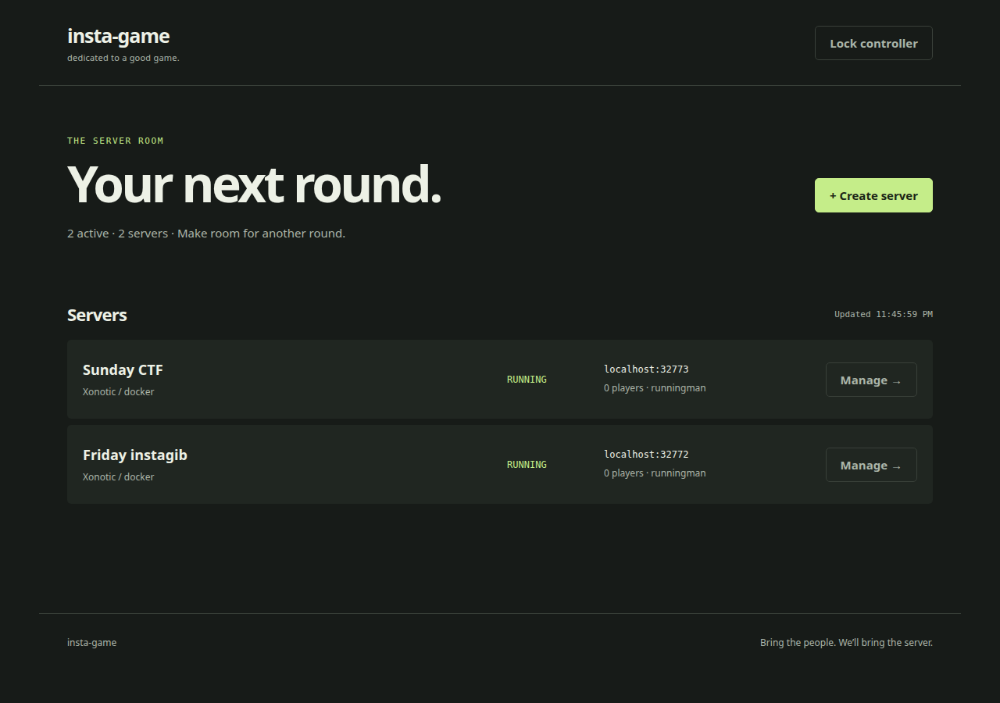

# insta-game

On-demand dedicated game servers, with a Go controller, CLI, and in-container
agent. Create several servers for the same game, configure them independently,
and manage them from the embedded web UI or terminal.

The new controller manages **local Docker**. Its infrastructure boundary is
provider-independent; Fly Machines and ECS instance providers are future work.
The existing AWS/Pulumi and TypeScript launcher remain available through the
[legacy deployment guide](docs/legacy-deployment.md).



## Run

Requires Go 1.26 and a local Docker daemon. Build or pull game images first; the
controller never pulls images or builds game engines implicitly.

```sh
make build
# Existing game images are ARM64; use a matching host or Docker emulation.
./build.sh xonotic
bin/insta-game serve
```

Open **http://localhost:3000**. The first run creates a controller token in
`.insta-game/token`; paste it into the login form. The web UI and CLI use the
same API. No Node build is needed for the new Go application.

```sh
bin/insta-game games
bin/insta-game create --game xonotic --name "Friday instagib" --id friday
bin/insta-game create --game xonotic --name "Sunday CTF" --id sunday --config ./ctf.cfg
bin/insta-game list
bin/insta-game logs friday
bin/insta-game console friday status
bin/insta-game stop friday
bin/insta-game start friday
bin/insta-game delete friday
```

`stop` keeps the container and its writable data. `delete` permanently removes
both; the CLI applies it immediately, while the web UI asks for confirmation.
Use a stable `--id` when retrying creation: the same ID/settings returns the
existing instance, and different settings return a conflict. Configurations
are captured at creation and applied before the game starts.

Servers default to stopping after 10 minutes of confirmed emptiness or 120
minutes of total runtime. `--idle 0` and `--max-runtime 0` disable these limits.
Bots are excluded where the game protocol identifies them. Query failures mean
"unknown", not "empty". Unexpected game/container exits remain failed until you
stop and start the server; they are not restarted indefinitely.

## Hosting and data

The controller binds HTTP and game ports to loopback by default. For a LAN host:

```sh
bin/insta-game serve --listen 0.0.0.0:3000 \
  --game-bind 0.0.0.0 --public-host 192.168.1.20
```

Use HTTPS in front of the controller when accessing it over an untrusted
network. The controller token grants full administration; this is a private
hosting tool, not a public multi-user service.

Docker allocates independent host ports. The agent port is always published on
loopback; game connection addresses use the actual allocated ports. TCP/UDP
pairs for the same game port share an external port. Stopping and restarting a
server may change its connection address, so use the current server page.

`--data` selects the private controller data directory. It contains a bbolt
transactional database and token file; back it up, keep its permissions private,
and run one controller per database. The database stores instance intent,
configuration snapshots, and credentials. Container writable layers isolate game
data between instances and survive stop/start. They are not durable backups;
deleting a container deletes its data. Catalog `volumes` and fixed `hostPort`
values belong to the legacy deployment and are deliberately not reused.

For games requiring licensed assets, supply their existing environment variables
(`FTEQW_DATA_URL`, `Q2REPRO_DATA_URL`, `IOQUAKE3_DATA_URL`, `UT99_DATA_URL`) to the
controller. New containers receive the asset URL, download into their own
filesystem, and cache downloads for subsequent starts. URLs are an operator
setting and are read when infrastructure is created; do not use mutable URLs
as a substitute for versioned assets.

The standalone controller image is built with `docker build -t insta-game .`.
On Linux it needs **host networking**, the Docker socket, and persistent data:

```sh
docker run --rm --network host \
  -v /var/run/docker.sock:/var/run/docker.sock \
  -v insta-game-control:/data \
  insta-game serve --listen 127.0.0.1:3000 --data /data --catalog /opt/games
```

The Docker provider is local to the controller: it connects to agents through
host loopback. A remote Docker daemon or bridge-networked controller is not
supported. Mounting the Docker socket grants control over that Docker host.

## One Go executable, explicit roles

```sh
bin/insta-game serve                  # API, embedded UI, instance reconciliation
bin/insta-game agent                  # One game process inside a game image
bin/insta-game help
```

The agent uses the existing `GAME_CMD`, `GAME_ARGS`, `GAME_PORT`, `CONFIG_PATH`,
`DATA_URL`, and `RCON_PASSWORD` environment variables. `TOKEN` is required for
management; `CONFIG_TEXT` supplies the launch configuration. `/status` reports
readiness, human player count where available, map, and process failure.
Authenticated `/logs`, `/config`, `/console`, `/restart`, and `/stop` handle
local management. Console commands go to process stdin; native remote RCON
clients are not implemented yet.

The game images retain `/usr/local/bin/sidecar` for existing deployments and
also include `/usr/local/bin/insta-game`. Both reuse `internal/agent`; only the
legacy sidecar entrypoint installs an ECS idle-shutdown callback. The portable
agent never needs cloud credentials.

## API

All `/api/` routes require `Authorization: Bearer <controller-token>`.

| Method | Route | Action |
| --- | --- | --- |
| GET | `/api/catalog` | Available game definitions and configuration defaults |
| GET / POST | `/api/instances` | List / create instances |
| GET / DELETE | `/api/instances/{id}` | Read / permanently delete an instance |
| POST | `/api/instances/{id}/start` | Request start |
| POST | `/api/instances/{id}/stop` | Request stop |
| GET | `/api/instances/{id}/logs` | Stream plain-text SSE log events |
| POST | `/api/instances/{id}/console` | Send `{ "command": "status" }` to stdin |

Creation accepts `id` (optional), `game`, `name`, `config` (optional),
`idleMinutes`, and `maxMinutes`. Mutations return promptly with HTTP 202;
reconciliation performs infrastructure operations in the background. Explicit
zero timeout values disable limits. The CLI/UI supply their own defaults.
Instance credentials are excluded from ordinary API responses.

## Development

```sh
make test        # go test -race ./...
make check       # go vet and generated Compose check
make build
```

An opt-in integration test exercises two real Xonotic containers, isolated
configurations/endpoints, database recovery, and independent stop/start/delete:

```sh
INSTA_GAME_DOCKER_CATALOG=/path/to/catalog go test -v ./internal/control \
  -run TestDockerTwoServersSurviveControllerRestart -count=1 -timeout=4m
```

The catalog must contain a `xonotic/game.json` pointing at an installed image
for the Docker host's architecture, with this branch's agent and game assets.
The test removes only the containers it creates.

See [architecture](docs/architecture.md) for package boundaries and the next
provider milestone. `compose.yml` is still generated by `generate-compose.py`;
do not edit it by hand.

### Native Linux engines

Use `serve --native-config /absolute/path/native.json` to enable native game
processes alongside Docker, then `create --provider local ...`. Each instance
gets its own copied assets, config, ports, detached agent, and writable data.
`--default-provider local` selects the default for new instances. See
[the native engine configuration](docs/architecture.md#native-processes).

The unified AWS provider and removal of the old deployment application remain
in progress; the [migration completion criteria](docs/go-unification.md) govern
this draft PR.
