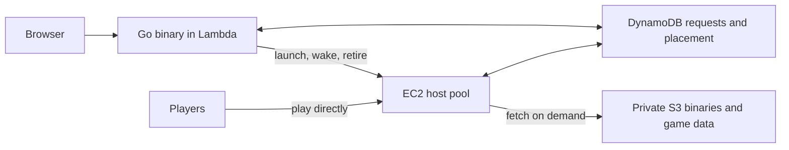

# Running servers

The controller saves settings, credentials, and desired state before allocating
resources. Reusing `--id` with the same settings is safe. Changing the default
provider affects new instances only.

| Provider | Stop | Start again | Delete |
| --- | --- | --- | --- |
| `local` | Stop the game; keep its agent and private directory | Restart the game with the saved configuration | Shut down the agent and remove the owned directory |
| `docker` | Stop the container; keep its writable layer | Start the same container | Remove the owned container and its data |

Mutations request a desired state; check `show` or the UI for completion and
errors. Deletion permanently removes instance data. Use the current connection
address after a host restart; AWS may assign a different public IP.

By default, games stop after 10 empty minutes or 120 minutes of runtime. `--idle 0` and `--max-runtime 0` disable those limits. Query
failures mean unknown activity. Bots are excluded where the protocol identifies
them. A game crash requires an explicit stop/start; it is not an unlimited
restart loop. Keep the controller running to enforce timeout policy.

`--data` selects the controller directory, containing the private bbolt database,
token, and native instance files. Back up this directory and the game data you
need. Run one controller per database. Stopping the controller leaves game
resources running; restarting it with the same data and provider configuration
resumes reconciliation.

Game images keep a seed copy outside `/opt` and populate each instance's full
`/opt` game root on first startup. Docker retains it in the container's writable
layer. Completed seeding is recorded and existing files are preserved. Changing
an image does not upgrade an existing seeded root.

## Native Linux games

Install the engine and assets yourself, then define their paths and arguments in
`native.json`. Assets are copied into each instance; directories and regular
files are accepted, while symlinks are rejected.

```json
{
  "fteqw": {
    "command": "/srv/games/fteqw.sv",
    "assets": "/srv/games/quake-assets",
    "configPath": "id1/server.cfg",
    "args": ["-dedicated", "8", "-nohome", "-basedir", "{data}",
             "-game", "id1", "-port", "{port}",
             "+set", "pr_ssqc_memsize", "67108864",
             "+set", "sv_listen_nq", "1", "+exec", "server.cfg"]
  }
}
```

```sh
bin/insta-game serve --native-config ./native.json --default-provider local
bin/insta-game create --provider local --game fteqw --name "Quake night"
```

The FTE example caps the QuakeC VM at 64 MiB; its default 2 GiB allocation can fail
on small hosts. Larger mods may need a higher value.

`command` and `assets` must be absolute; `configPath` is relative to the copied
assets. Arguments support `{data}`, `{config}`, `{port}`, and `{port:27960}` for
another catalog port. Configure every engine port that could collide. Native
game bind addresses are controlled by engine arguments/configuration;
`--game-bind` controls Docker port publishing. Native supervision requires Linux.

## AWS

One EC2 host runs the controller and games. Size it for your games and players.
Encrypted gp3 retains the database and game files while EC2 is stopped.
Destroying the stack deletes that disk and all saved games. The AMI is pinned
at creation; updating the launch page keeps the game host and disk.

The supplied Docker images target ARM64. For those images, provision a `t4g`
host and build an ARM64 controller. Native AMD64 deployments can use `t3` or
`t3a` instead; the installer checks the controller binary against the host.

```sh
ssh-keygen -t ed25519 -N '' -f ./game-host-key
bin/insta-game aws plan --stack insta-game-host --instance-type t4g.small \
  --disk-gib 32 --operator-cidr YOUR_PUBLIC_IP/32 \
  --game-cidr YOUR_GATEWAY_PUBLIC_IP/32 --public-key ./game-host-key.pub
# Review the changes and apply their exact ARN:
bin/insta-game aws apply --stack insta-game-host --change-set REVIEWED_ARN \
  --key ./game-host-key --token-file ./game-host-token --out ./aws.json

CGO_ENABLED=0 GOOS=linux GOARCH=arm64 go build -o bin/insta-game-linux-arm64 ./cmd/insta-game
bin/insta-game aws install --config ./aws.json \
  --binary ./bin/insta-game-linux-arm64 --catalog ./docker-containers --pull-images
bin/insta-game aws wake --config ./aws.json
```

Installation enables Docker and uploads the controller plus catalog metadata and
configs. `--pull-images` pulls the images named by that catalog; omit it when
images are already installed. Use images built from the same release as the
controller. `--env-file ./host.env` installs a private systemd environment file
for asset URLs such as `FTEQW_DATA_URL`, `Q2REPRO_DATA_URL`, `IOQUAKE3_DATA_URL`,
and `UT99_DATA_URL`, or Discord settings. Keep those URLs and credentials out of
the catalog. Limit a custom catalog to the games you want installed. An 8 GiB
root disk can be too small for several games and their assets. FTE defaults to
a 64 MiB QuakeC arena for small hosts; larger mods can set `pr_ssqc_memsize` in
their game configuration.

Native engines are optional. Upload a directory containing any number of engines
and runtime files with `--engines`, an asset directory with `--assets`, and
profiles with `--native-config`. Profile paths on the host use
`/opt/insta-game/engine` and `/opt/insta-game/assets`; preserve per-game
subdirectories. Stop affected games before updating their engines or assets.
Select `--provider local` when creating a native instance. Docker is the host's
default provider.

Use the IP returned by `aws wake` to create saved instances through the ordinary
controller API. All catalog games use the same creation and lifecycle commands:

```sh
bin/insta-game create --url https://HOST_IP:3000 --token-file ./game-host-token \
  --provider docker --game openarena --id arena --name "Arena night"
bin/insta-game aws status --config ./aws.json
bin/insta-game aws stop --config ./aws.json
# Permanent deletion of the host and its saved games:
bin/insta-game aws destroy --config ./aws.json
```

SSH and the controller API accept only `--operator-cidr`. Game TCP and UDP use
`--game-cidr`: restrict it to your gateway public IP when proxying, or to player
networks for direct hosting. Its default is `0.0.0.0/0`. Without the launch page,
the VM receives no AWS role. The operator binary uses reviewed CloudFormation changes, verified
SSH installation, and token-pinned controller TLS.

The controller stops empty games according to their idle policies, then powers
off the host after all games have stopped for two minutes. The host also has a
boot lifetime cap (six hours by default). Set `aws install --host-max-runtime 0`
to disable that cap, or give a duration such as `12h`. Starting EC2 can change its public IP; the gateway
resolves fresh game endpoints after startup. Standard CPU credits avoid surplus
credit charges but can throttle sustained workloads.

You pay for the retained disk, running hours, public IPv4 hours, and transfer.
Games share one VM. Count startup and idle grace periods in running hours;
compute and public IPv4 charges end when EC2 reaches `stopped`.

Catalog `gameArgs` can use `{port}` to keep the engine's UDP port equal to its
public Docker port. FTE uses this because NetQuake embeds the port in sign-on.
Existing instances keep their saved engine arguments and container mappings;
create a new instance with the updated catalog for this direct-connection fix.
Keep the original until you have copied its assets/config and tested the replacement.

## AWS launch page

One Lambda page manages a fleet of sleeping EC2 hosts. Choose a game and name;
placement handles the host. The full deployed catalog stays visible with zero
hosts. Games connect directly to EC2 once ready.



Create a fleet with an explicit host limit. The default fleet host is
`t4g.small`, with a 32 GiB encrypted disk:

```sh
bin/insta-game aws plan --stack insta-game-fleet --max-hosts 2 \
  --operator-cidr YOUR_PUBLIC_IP/32 --public-key ./game-host-key.pub \
  --lobby-token-file ./invitation
# Review, then apply the exact printed change set:
bin/insta-game aws apply --stack insta-game-fleet \
  --change-set REVIEWED_ARN --out ./fleet.json
```

This creates the network, request table, private artifact bucket, and launch
permissions. It creates no EC2 instance. Build a static Linux ARM64 binary, then
publish the catalog and assets:

```sh
CGO_ENABLED=0 GOOS=linux GOARCH=arm64 go build -o bin/insta-game-linux-arm64 ./cmd/insta-game
bin/insta-game aws lobby --config ./fleet.json \
  --binary ./bin/insta-game-linux-arm64 --catalog ./docker-containers --assets ./game-assets
bin/insta-game aws apply --config ./fleet.json \
  --change-set REVIEWED_ARN --out ./fleet.json
```

`game-assets` contains `fteqw.zip`, `q2repro.zip`, `ioquake3.zip`, and `ut99.zip`.
Supply your own licensed data. ZIP paths start at `/opt`: Quake data lives under
`id1/`, Quake II under `baseq2/`, Quake III under `baseq3/`, and UT99 includes its
engine and data directories. Use maps and configs matching those assets. Other
games ship their data in their images. A smaller operator catalog may omit games
you don't own. Missing required archives fail deployment before hosts launch.

Share `LobbyURL` from `fleet.json` and the invitation key. No operator machine,
SSH session, or wake gateway is needed to keep the page accessible. The same Go
binary runs Lambda, the host controller, and each game agent. Hosts fetch images
and private assets when first needed, then reuse their caches. Bootstrap retries
failed downloads. Nothing needs to run once per game before it appears in the menu.

Placement uses reserved CPU, RAM, and disk. It fills fitting awake hosts, then
wakes a fitting sleeping host, then creates another up to `--max-hosts`. Duplicate
requests share one durable assignment. **Stop keeps data and its reservation;
Remove frees it.** Stopped servers stay on their original disks. Empty hosts
sleep after two minutes. Hosts without saved servers are terminated and their
disks deleted. See [capacity defaults](capacity.md) before changing player counts
or mods; reservations are estimates, not container resource limits.

Use `--fleet-config ./limits.json` with `aws lobby` to override game reservations,
idle minutes, or maximum runtime. It is a JSON object using the fields in
`internal/fleet.Config`; omitted fields keep defaults. Overrides cannot exceed
reviewed host limits or capacity budgets. The default game idle timeout is
15 minutes; maximum runtime is six hours. A six-hour host boot timer also stops
failed startup loops. Unacknowledged requests time out after 20 minutes and can
be retried from the page. Closing the page does not cancel a saved request.

For a temporary deployment, `aws lobby --expires-after 2h` sets an absolute end
time. The scheduled reconciler then deletes its hosts and saved games; the small
Lambda/table/bucket remain until `aws destroy`. This is destructive, unlike Stop.

```sh
bin/insta-game aws status --config ./fleet.json
bin/insta-game aws stop --config ./fleet.json       # stop games, keep data
bin/insta-game aws destroy --config ./fleet.json    # remove the entire deployment
```

For code-only updates, `aws lobby --config ./fleet.json --binary ./new-binary`
reuses the deployed catalog, assets, and limits. Repeat the reviewed apply. Pass
`--catalog` or `--assets` only to change them. An explicit `--expires-after 0`
clears a temporary deadline; omitted flags preserve it.

Releases pin image digests, assets, and host launch versions. Existing hosts and
saved games keep their release. UI-only updates reuse compatible hosts; engine,
asset, or lifecycle changes use new host slots within the same limit. Remove old
saved servers when no longer needed. Hardware changes require
a separate fleet to avoid changing saved-data and capacity assumptions. Review
all plans; no source migration replaces an existing host.

There is no always-on gateway, NAT gateway, load balancer, or reserved public IP.
Sleeping hosts cost retained disk storage; Lambda, table operations, private game
assets, short-lived logs, and transfer also incur usage charges. Standard CPU
credits avoid surplus CPU charges but can throttle sustained load. `aws destroy`
closes admission, verifies owned host and disk deletion, empties the private
bucket, and deletes the stack. It leaves unrelated infrastructure alone.

## Stable game addresses

Run the gateway on an existing machine reachable by players. It starts a saved
game through its controller; `--config` additionally wakes an AWS host. Without
AWS, use `--url` and `--token-file` for a native or Docker controller:

```sh
bin/insta-game wake --config ./aws.json \
  --route quake3://100.YOUR.TAILNET.IP:27960=arena

bin/insta-game wake --url http://127.0.0.1:3000 --token-file .insta-game/token \
  --route xonotic://100.YOUR.TAILNET.IP:26000=friday \
  --route bzflag://100.YOUR.TAILNET.IP:5154=tanks
```

Repeat `--route PROTOCOL://ADDRESS=INSTANCE_ID` for other saved games. Protocols
are listed in the [game table](../README.md#games). Omitting the protocol selects `quake1`. An optional
`/CATALOG_PORT` after the instance ID selects a specific backend endpoint.
The gateway needs the controller token and, for AWS, operator credentials.
Keep listeners on private/tailnet addresses.

Players use the gateway address once. The gateway holds the connection while
the game starts, then completes the real server handshake. Quake and Xonotic
show loading text. Quake II/III and OpenArena receive connection progress; UT99
keeps its connecting screen alive; BZFlag receives server messages. Startup is
bounded to three minutes. A failed start reports an error through the game protocol.

Each player has a separate backend socket. BZFlag's TCP greeting and UDP link
negotiation use the same front port. Its initial greeting is shared by joins and
queries, so BZFlag TCP queries can wake the host. Quake-family browser queries
and UT99 GameSpy queries do not wake it; the gateway does not provide a full
server-browser service or proxy UT99's additional query ports. Use direct
hosting when those services are required.

The FTE backend must use `sv_listen_nq 1` for NetQuake loading; the supplied config
and native example set it. Reliable packet sequence translation accounts for
the loading messages; unreliable packets remain unchanged. QuakeWorld is
unsupported. Xonotic uses the DarkPlaces 7 handshake with the same reliable
loading transport.

A gateway permits 64 clients. A BZFlag client shares one admission slot across
TCP and UDP. Failed starts have a one-minute cooldown; waiting and connected UDP-only
clients expire after one minute without traffic. BZFlag support targets protocol
0221 (the 2.4 series). Replay and `-solo` robot connections are unsupported. The gateway carries gameplay traffic, so its location and bandwidth affect latency
and capacity. It needs a persistent TCP/UDP listener. Lambda function URLs cannot receive game UDP.

## Controller access and Discord

HTTP listens on loopback by default. For Docker games reachable on a LAN:

```sh
bin/insta-game serve --listen 0.0.0.0:3000 \
  --game-bind 0.0.0.0 --public-host 192.168.1.20
```

Use `serve --tls` with the CLI's pinned TLS client, or put HTTPS in front of
the controller for browser access. Its token grants full
administration. The Docker provider requires a local daemon and reaches agents
through host loopback. A containerized controller therefore needs Linux host
networking, the Docker socket, and persistent storage:

```sh
docker build -t insta-game .
docker run --rm --network host \
  -v /var/run/docker.sock:/var/run/docker.sock -v insta-game-control:/data \
  insta-game serve --listen 127.0.0.1:3000 --data /data --catalog /opt/games
```

Discord uses the same instance API. Set `DISCORD_PUBLIC_KEY` and
`DISCORD_GUILD_ID` for `serve`, and point the application's interaction endpoint
at the controller's public HTTPS `/discord` route. Preview command definitions
with `bin/insta-game discord commands`. Register them with
`bin/insta-game discord register` using `DISCORD_APP_ID`, `DISCORD_GUILD_ID`, and
`DISCORD_BOT_TOKEN`. This replaces that guild's application command list with
`/create`, `/start`, `/stop`, and `/status`; start/stop take instance IDs.

## CLI and catalog

Client flags such as `--url` and `--token-file` go before instance IDs.
`INSTA_GAME_TOKEN` overrides the token file. The controller reads game metadata
and default configs from `docker-containers`; `serve --catalog PATH` selects
another catalog. Build or pull Docker images before creating instances.

```sh
bin/insta-game games
bin/insta-game create --provider docker --game xonotic --name "Friday games" --id friday
bin/insta-game create --provider docker --game xonotic --name "Sunday CTF" --id sunday --config ./ctf.cfg
bin/insta-game list
bin/insta-game show friday
bin/insta-game logs friday
bin/insta-game console friday status
bin/insta-game stop friday
bin/insta-game start friday
bin/insta-game delete friday
```
